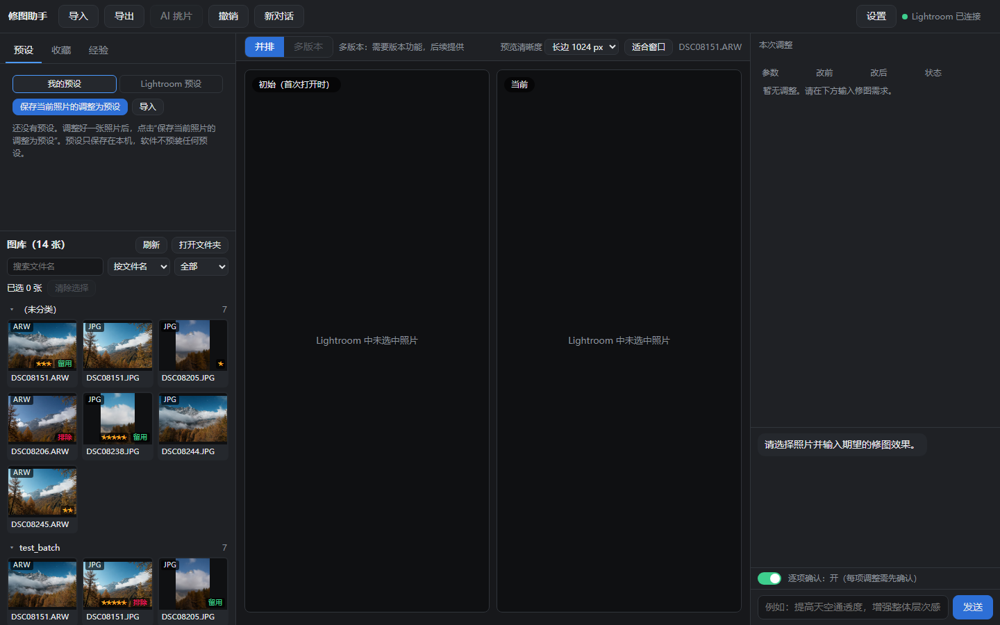
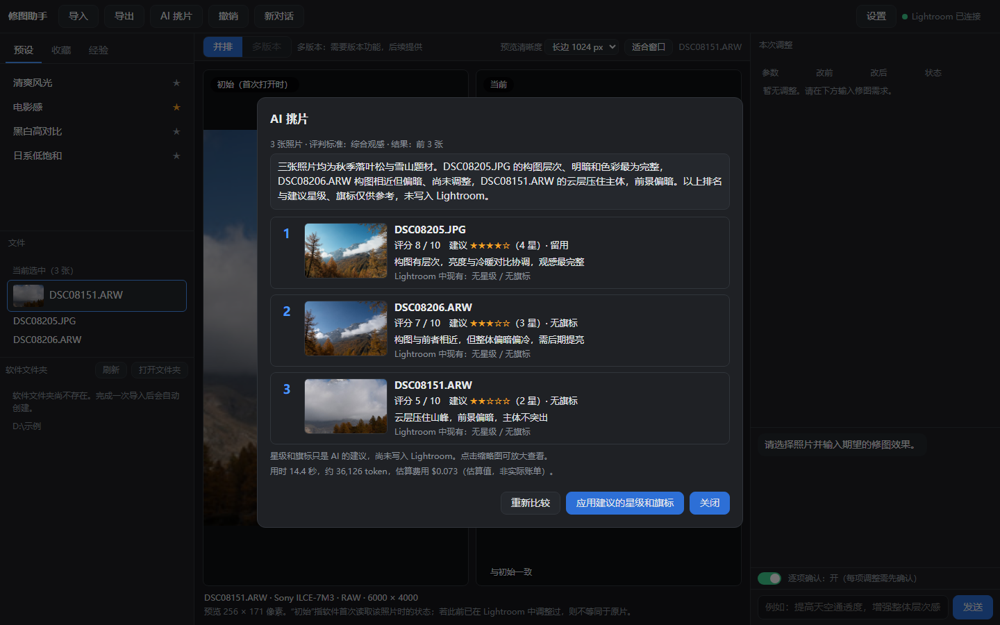

# 📸 Latos Hue

**Latos Hue is a Windows AI photo editing app for Adobe Lightroom Classic: import, select, retouch and export photos with Claude or Codex.** Lightroom Classic works in the background as the editing engine.

The project also provides **LrMCP**, a standalone Lightroom Classic plug-in and MCP (Model Context Protocol) server for compatible AI clients. It can be installed without the Latos Hue desktop app.

  [](https://github.com/Denvolatos/lightroom-mcp-latos-hue/releases/latest)

[中文说明](README.md) · [Changelog (app)](app/CHANGELOG.md) · [Security](SECURITY.md) · [Contributing](CONTRIBUTING.md) · [LrMCP (server for AI clients)](#lrmcp-the-server-for-ai-clients)

> 🤖 **AI assistant reading this for a user?** Read [`AI_GUIDE.md`](AI_GUIDE.md) (it covers installing and using the LrMCP server).





*The photos and folders in the screenshots are test samples. The interface is in Chinese.*

## ✨ What it does

- **Import:** choose photos from a memory card or any folder; they are copied into the app's work folder (the originals are not touched) and added to your Lightroom catalog.
- **Gallery:** browse thumbnails grouped by folder, search, filter, sort and multi-select; the selected photos are what the AI works on. "换目录" (change folder) lets you browse any photo folder on your computer (it is only read; nothing is moved or copied); photos that are not in the Lightroom catalog yet can be added in place.
- **AI photo picking:** select a few photos and let the AI compare them; it suggests a ranking plus star and flag ratings, shown in the app first, and **written only after you confirm**.
- **AI retouching:** tell the AI the look you want in plain words. You can turn on "confirm each step" (the AI asks before every change), **every step can be undone**, and one click returns the photo to how it was before.
- **Versions:** save how a photo looks now as a named version, compare "saved version" and "current" side by side later, go back to a version after confirming, and undo that switch.
- **Reuse an edit:** preview a verified slider change on other selected photos, inspect each result, then confirm; up to 10 photos per batch, with batch restoration.
- **Presets, experience, favourites:** save your own presets, keep notes on the colour experience the AI learned, and mark favourite photos. They live only on your own computer.
- **Export:** JPEG or TIFF (8 or 16 bit), you choose the folder and size, existing files are never overwritten.
- **Small conveniences:** optional automatic start of Lightroom, a first-run "environment check" wizard, and an update check (it only tells you, it never installs by itself).

The AI can be **Claude** (the Claude Code command line already installed and signed in on your computer) or **Codex** (the Codex command line, installed and signed in). **You choose which one the first time you open the app**; the app does not decide for you and starts no AI before you have chosen.

## 📦 Install

**Requirements:** Windows 10 / 11; **Adobe Lightroom Classic** installed (developed and tested on 15.x); and the **Claude Code** or **Codex** command line installed and signed in (at least one).

1. Download `LatosHue-Setup-*.exe` from the [latest release](https://github.com/Denvolatos/lightroom-mcp-latos-hue/releases/latest) and compare the SHA-256 on the page. **Each release has two installers: most people want `LatosHue-Setup-*.exe` (the desktop app, which already includes the Lightroom plug-in); install `LrMCP-Setup-*.exe` only if you want the MCP server for an AI client such as Claude Code or Codex.** Both carry the same version number.
2. **Double-click it from your own File Explorer** (not from a shell started by Claude Desktop, see the MSIX note in the LrMCP part below). No administrator rights and no Python needed.
   The installer is not code-signed, so Windows SmartScreen may say "unknown publisher": click "More info", then "Run anyway".
3. The installer puts the Lightroom plug-in in place for you. **Restart Lightroom after installing.**
4. If it says the Microsoft Edge WebView2 runtime is missing (Windows 11 has it, a few Windows 10 machines do not), download it from Microsoft's official page as the message suggests.

Uninstalling removes the program and the plug-in; your settings and experience notes are kept by default (it asks whether to delete them too); your photos are never deleted.

## 🚀 First use

1. Open Latos Hue. An "**environment check**" list appears: photo work folder, Lightroom, the Lightroom plug-in, the AI assistant. For anything not ready it tells you what to do next (for example "choose a folder", "choose the Lightroom program", or sign in to Claude or Codex in a terminal first). You can reopen it any time from Settings.
2. In the "AI 助手" (AI assistant) item click "**使用 Claude**" (use Claude) or "**使用 Codex**" (use Codex). Next to each button you see its state (installed and signed in / installed but not signed in / not installed); you may pick one that is not installed yet, and the list then tells you what to do next. To change it later click "更换 AI 来源" (change AI source) or use Settings (it takes effect with the next "new conversation"). Turn on "start Lightroom automatically" in Settings if you like.
3. Click "Import" (导入), pick a folder with photos, confirm; the photos are copied to your work folder and added to the Lightroom catalog. Or skip importing: click "换目录" above the gallery and browse a folder of photos you already have.
4. Click photos in the gallery on the left and tell the AI the look you want on the right, or select several photos and click "AI 挑片" (AI picking).
5. Not happy? Click "撤销" (undo). Happy? Click "导出" (export).

> Try it on a few test photos first, and back up your Lightroom catalog (`.lrcat`) before using it on important work.

## 🔒 Privacy and data

- **Your original photos are processed on your computer only**; the app does not upload them. The AI's edits are stored in the Lightroom catalog and can be undone; **the original photo files are not changed**. A folder you browse with "换目录" is only read, and "加入 Lightroom" (add to Lightroom) adds photos in place, without moving or copying them.
- **When you retouch or pick photos, a preview of the selected photos is sent to the AI service you chose** (the provider behind Claude or Codex). The app uploads nothing else about your photos.
- The app **does not store your account and does not sign in for you**; you sign in yourself in the Claude / Codex command line.
- Settings, presets, favourites and experience notes are stored on your own computer in `C:\Users\<you>\LrMcp`.
- The **update check** only contacts this project's release page on GitHub and sends no personal information; you can turn it off in Settings.
- No usage data is collected.

More detail in [SECURITY.md](SECURITY.md).

## 🤖 About the AI connection

Latos Hue talks to the AI by calling the **Claude Code or Codex command line that is already installed and signed in on your computer**. It does not bypass any sign-in or usage limit; it uses your own account's allowance. Please read the terms of use of the provider you choose (Anthropic, OpenAI, ...) yourself and make sure your use complies with them.

## ⚠️ Known limitations

- Windows only; needs Lightroom Classic and a signed-in Claude Code or Codex command line.
- The installer is not code-signed; Windows SmartScreen may show "unknown publisher" (see the install steps).
- Not yet verified well enough on real machines: the look at 125% / 150% Windows scaling; bulk imports of more than 100 photos and real memory cards; full-size 16-bit TIFF export.
- Export is JPEG and TIFF only, no PNG.
- No Mac version.
- The AI cannot change masks (local adjustments).

The full version history and the per-stage "still to verify" lists are in [app/CHANGELOG.md](app/CHANGELOG.md) (in Chinese).

---

# LrMCP: the server for AI clients

What follows is the Lightroom plug-in and MCP server (**LrMCP**) that Latos Hue is built on. You can also install it **on its own** in Claude Code, Codex or another MCP client, without Latos Hue. Since 1.0.1 it shares the version number and the release (tag `v*`) with Latos Hue; see [CHANGELOG.md](CHANGELOG.md).

**Let Claude or Codex look at your photos in Adobe Lightroom Classic.**
A Lightroom plug-in plus a small MCP server. It can see the photo you selected, read its develop settings, and show
the assistant a preview with histogram numbers. It can also make guarded develop changes, update catalog information,
and save old values for restoration.

  

> ⚠️ **Early version.** Tested only on Windows 11 with Lightroom Classic 15.2. An installer is published, but it has not been install/uninstall-tested on a clean machine yet (待验证).
> Not affiliated with Adobe.

### ✨ What it does

| Tool | What it gives the assistant |
|---|---|
| `lr_status` | Is Lightroom connected, its version, the open catalog, how many photos are selected |
| `lr_list_selected` | Selected photos: name, format, rating, size, ISO / aperture / shutter / focal length / lens / camera |
| `lr_get_develop` | Current develop settings: exposure, contrast, highlights, shadows, white balance, HSL, … |
| `lr_get_preview` | A 1024 px preview (256–2048) **plus numbers**: brightness, clipped highlights/shadows, warm/cool balance |
| `lr_doctor` | Self check in Chinese: what is wrong and how to fix it |
| `lr_set_develop` | **Changes** supported settings of one photo with range and step limits; `preview=true` returns before and after previews with numeric differences |
| `lr_review_selected` | Show previews and statistics for up to 10 selected photos to help choose picks; it does not change ratings or flags |
| `lr_restore` | Puts the sliders of one earlier change back to their old values |
| `lr_restore_original` | Puts every slider LrMCP changed on a photo back to its value before LrMCP's first change (`dry_run` shows what it would do) |
| `lr_get_metadata` / `lr_set_metadata` | Read and change catalog information: rating, flag (pick / reject), colour label, title, caption, keywords; old values are saved first and can be restored |
| `lr_batch_set_develop` | Batch: add the same relative change to several photos (at most 10). Dry run first (changes nothing, returns each photo's result and a plan id), executed only with that plan id; the whole batch can be undone at once |
| `lr_list_presets` / `lr_apply_preset` | Find and apply presets without masks; save the old settings first and optionally return before and after previews |
| `lr_plan_from_edit` | Turn a verified single-photo slider edit into a dry-run plan for other photos; use the batch tool to apply after approval |
| `lr_export` | **Exports** one photo as a JPEG (adjustments included), original size or a chosen size, to **the place you name in the chat**; never overwrites, not sent to the AI service |
| `lr_save_version` / `lr_list_versions` / `lr_apply_version` / `lr_delete_version` | **Named versions**: save how a photo looks now under a name (kept on your computer), go back to any version in one step, undo with `lr_restore` |
| `lr_compare` | Puts the current look and the saved versions side by side in one picture, with numbers and differences |
| `lr_list_edits` | Lists the changes LrMCP made (id, time, photo, sliders, restored or not) |

Example: select a photo and ask *"Look at the selected photo and tell me what is wrong with the exposure."*
The assistant gets the picture and numbers such as `mean brightness 77.6`, `warm/cool index −9.9 %` and can say
*"a bit dark and cool"* with evidence.

#### What changing means, and how it is kept safe

- **Only sliders, only a short list**: 89 sliders (exposure, the ten global ones above, 24 HSL values, **temperature / tint of RAW photos**, **colour grading**, **camera calibration**, **parametric curve**, **sharpening / noise reduction / vignettes / grain / defringe**, **crop and straighten**)
  plus **4 point curves** (luminance, red, green, blue). Masks cannot be changed (writing them through the SDK was measured to be unreliable); presets without masks can be applied; JPEGs have no kelvin values, so their white balance cannot be changed.
- **Range limits** (exposure ±5, the rest ±100) and a **step limit per call** (exposure ±1, the rest ±30): a bigger jump
  is refused and the assistant is told to go in several steps and look at the preview each time. Lightroom itself
  does *not* check ranges (measured: it stores out-of-range values as given), so this project does.
- **The old values are saved to disk before anything is written** (`C:\Users\<you>\LrMcp\edits`). Restoring means
  writing them back; Lightroom's snapshots and undo were measured to be unreliable, so they are not used.
- **Read-only switch**: create the file `C:\Users\<you>\LrMcp\readonly` and every change is refused, by the server and
  by the plug-in. Delete the file to allow changes again.
- One photo per call. The plug-in re-checks every rule itself; it does not trust the server.
- Changes appear in Lightroom's History panel as `LrMCP <id>` steps. **Back up your catalog (`.lrcat`) before using this
  on real work, and try it on a test catalog first.** Before restoring, the tool checks whether those
  settings were changed afterwards (also by hand in Lightroom); on a conflict it refuses by default and only continues with
  `force=true` after you have agreed.

Files it creates: preview JPEGs (not added to your catalog), a token, a log and the saved change records, all in
`C:\Users\<you>\LrMcp`.

### 🏗️ How it works

```
Claude / Codex ──(MCP, stdio)──▶ lrmcp (Python server, local queue on 127.0.0.1:58770)
                                          ▲
              Lightroom plug-in (Lua) polls the queue, runs a whitelisted command, sends the answer back
```

- Local only: the server binds `127.0.0.1` exclusively, requests need a random token, the `Host` header must match,
  and requests with an `Origin` header (browsers) are refused. Several AI sessions can run at once (one server each, ports 58770–58789).
- The plug-in runs a fixed whitelist of commands and never takes a file path from a request. A write needs a whitelisted
  slider, a value in range, a small enough step, and no read-only switch.
- Note: the images and photo information the tools return go to the AI service you use. See [SECURITY.md](SECURITY.md).

### 🧰 Requirements

- Windows, Adobe Lightroom Classic (developed on 15.2; SDK 15.x), Python 3.10+ (tested with 3.12).
- Claude Code, Codex, or another MCP client (Claude Code was tested; Codex was not).

### 📦 Install with the installer (no Python needed)

1. Download `LrMCP-Setup-*.exe` from [Releases](https://github.com/Denvolatos/lightroom-mcp-latos-hue/releases/latest) and compare the SHA-256 on the page.
2. **Double-click it from your own File Explorer** (not from a shell started by Claude Desktop, see the MSIX note below). It is not code-signed, so Windows SmartScreen shows "unknown publisher".
3. Restart Lightroom and your AI assistant, then have it call `lr_status`.

### 🚀 Install from source

1. **Server** (normal PowerShell):
   ```powershell
   pip install ./server
   lrmcp register --dry-run   # shows what it would do
   lrmcp register             # registers "lightroom_mcp" with Claude Code and/or Codex (uses their own CLIs)
   ```
2. **Plug-in**: copy `plugin/lrmcp.lrdevplugin` to `%APPDATA%\Adobe\Lightroom\Modules\LrMcp.lrplugin`, delete
   `DevRun.lua` and the `devscripts` folder from the copy (they are development helpers), and restart Lightroom.
   In *File → Plug-in Manager* LrMCP should be enabled. `powershell -ExecutionPolicy Bypass -File build.ps1`
   builds a clean staged copy plus an installer (needs the conda env and Inno Setup, see [CONTRIBUTING](CONTRIBUTING.md)).
3. Restart your assistant, then ask it to call `lr_status`. If something fails, ask for `lr_doctor`.

> **Windows gotcha:** *Claude Desktop is an MSIX app*, and Windows silently redirects what programs it starts write to
> `AppData`. Run installers and copy steps from your own PowerShell, not from a shell started by Claude Desktop.
> That is also why this project keeps its shared files in `C:\Users\<you>\LrMcp`, not in `AppData`.

Claude Desktop is not registered automatically (its config file location depends on how it was installed); add the
command by hand under *Settings → Developer → Edit Config*.

### 💬 Feedback

Found a problem, or got it working in another AI app? **[Open an issue](../../issues/new/choose)** (bug report,
compatibility report, feature request) or start a **[discussion](../../discussions)**. The forms ask for the output of
`lr_doctor`, which makes most problems easy to find. Please never attach photos or catalogs. No usage data is collected.

### 🗺️ Roadmap

| Version | Plan |
|---|---|
| 0.1 | Read-only: look at photos, develop settings, preview, histogram numbers, self check |
| 0.2–0.11.2 | Guarded single-photo edits, catalog metadata, batch dry runs, presets, and restoration; see the tools above |
| 0.15 | Import command for the desktop app only (not an AI tool, the tool count is unchanged): adds one photo from disk to the catalog as "add, do not move"; the plug-in re-checks path and format (reload the plug-in once after updating) |
| 0.14 | Reconnect fix: a restarted server is found again within about a second or two, no more plug-in reload (one reload needed after updating) |
| 0.13 | Full-size export (to the place you name in the chat), named versions, side-by-side comparison, region analysis in the preview numbers |
| 0.12 | Restore conflict protection, before/after previews, review of several selected photos, and batch plans from verified edits (a contribution by Galio1991) |
| later | Preset amount slider, batch presets, installer acceptance on a clean Windows machine (macOS, Photoshop, Premiere paused; masks measured unreliable, not planned) |

Reported by the contributor: on Lightroom Classic 15.0 with an isolated test catalog, an iPhone ProRAW DNG passed a temperature edit and full restoration. That is their verification; we have not reproduced it (待验证). If `Temperature` / `Tint` is missing on a freshly imported RAW, open the photo in Develop once before calling the tool.

Masks and AI features depend on what Adobe's SDK offers and are not promised.

### 📚 Docs

Design notes are in Chinese for now: [`docs/方案.md`](docs/方案.md) (plan), [`docs/实验记录.md`](docs/实验记录.md) (what was
measured on Lightroom Classic 15.2: e.g. writes need `withWriteAccessDo`, snapshots and undo are unreliable),
[`docs/实现记录.md`](docs/实现记录.md) (implementation notes).

### 🙏 See also

Other Lightroom Classic MCP projects, studied for ideas (no code was copied):
[Automaat/lightroom-mcp](https://github.com/Automaat/lightroom-mcp) (TypeScript, MIT, many tools, Windows and macOS)
and [noopz/lightroom_mcp](https://github.com/noopz/lightroom_mcp) (Python, Apache-2.0).
This project aims to be small, careful about changes, Python-based and easy to install for non-programmers.

---

## ⚖️ License

The code of this project is licensed under the [GNU AGPL-3.0](LICENSE) (`AGPL-3.0-only`). In short: you may use, change and share it freely; if you distribute a modified version (or let others use it over a network) you must publish its source under the AGPL-3.0 as well, not keep it closed.
The AGPL-3.0 applies from the commits of 2026-11-03 on; the releases v0.1.0 to v0.14.0 published before remain under the MIT license.
Third-party packages and their licenses: [THIRD_PARTY_NOTICES.md](THIRD_PARTY_NOTICES.md) (the Latos Hue installer also puts a copy in the program folder).

**This software contains no Adobe software and is not an Adobe product.** Adobe and Lightroom are trademarks of Adobe Inc.; this project is not affiliated with, endorsed or sponsored by Adobe.
The Adobe Lightroom Classic SDK is not included in this repository and must not be committed. You need to install Lightroom Classic yourself.

## 🙌 Contributing and thanks

Issues and pull requests are welcome; please read [CONTRIBUTING.md](CONTRIBUTING.md) first (your contributions are licensed under the AGPL-3.0). For bug reports, compatibility reports and feature requests use [issues](../../issues/new/choose); please never attach photos or catalogs.

Thanks to the contributor **Galio1991**: restore conflict protection and the review and edit-reuse workflow (PRs #1 and #2, submitted under the MIT license; the copyright notice is in [THIRD_PARTY_NOTICES.md](THIRD_PARTY_NOTICES.md)), and Latos Hue's Codex support and several security fixes (PRs #4, #5 and #6), and the versions page, edit reuse, folder browsing and test workflow of 1.1.0 (PR #7).
