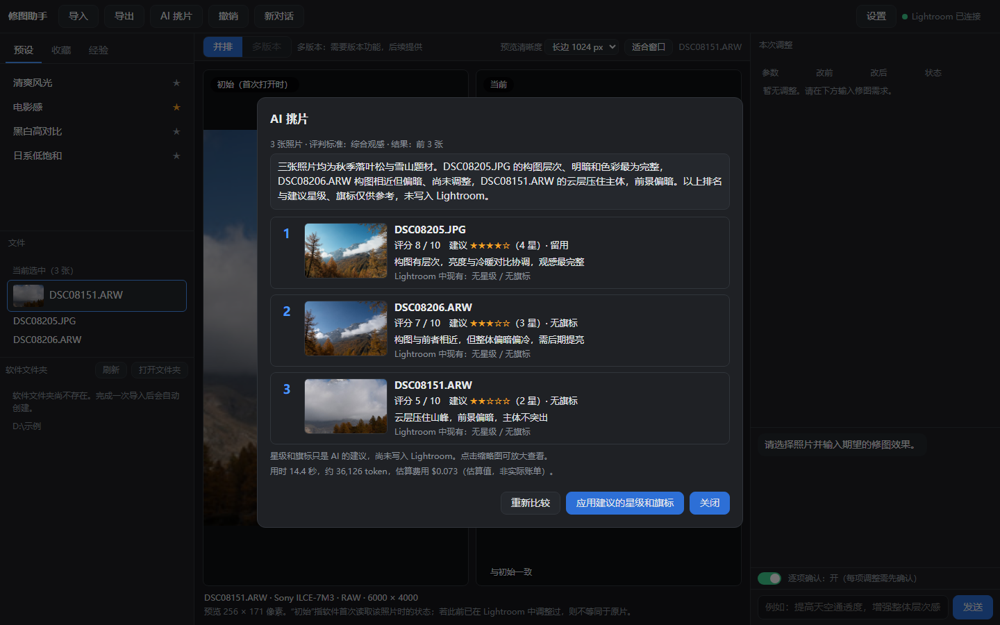
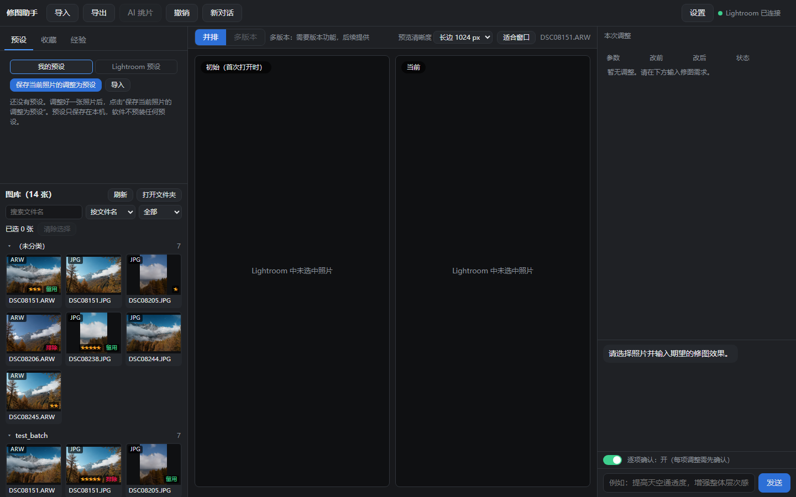

<div align="center">

# 📸 Latos Hue（修图助手）

**让 AI 帮你在一个窗口里挑片、修图、导出。**<br>
Lightroom Classic 在后台当引擎，原片不会被改动，每一步修改都能撤销。

[](https://github.com/Denvolatos/lightroom-mcp-latos-hue/releases/latest)

[](https://github.com/Denvolatos/lightroom-mcp-latos-hue/releases/latest) [](https://github.com/Denvolatos/lightroom-mcp-latos-hue/releases)  

[English](README.en.md) · [更新日志（软件）](app/CHANGELOG.md) · [安全说明](SECURITY.md) · [参与贡献](CONTRIBUTING.md) · [LrMCP（给 AI 客户端用的服务端）](#lrmcp给-ai-客户端直接用的服务端)



<sub>截图里的照片和文件夹都是测试用的示例。</sub>

</div>

**Latos Hue 是基于 Adobe Lightroom Classic 的 Windows AI 照片编辑软件：使用 Claude 或 Codex 导入、挑选、修图和导出照片。** Lightroom Classic 在后台作为修图引擎。

项目还提供 **LrMCP**：可独立安装的 Lightroom Classic 插件与 MCP（Model Context Protocol）服务端，供支持 MCP 的 AI 客户端使用，无需安装 Latos Hue 桌面软件。

> 🤖 **你是 AI 助手，用户让你看这个仓库？** 请读 [`AI_GUIDE.md`](AI_GUIDE.md)（那是 LrMCP 服务端的安装和使用步骤）。



## ✨ 能做什么

- **导入：** 从相机存储卡或任意文件夹选照片，复制一份到软件的工作文件夹（原片不动），并加进 Lightroom 目录。
- **图库选片：** 在软件里按文件夹分组浏览缩略图，搜索、筛选、排序、多选；选中的照片就是 AI 要处理的对象。点“换目录”可以直接浏览电脑上任意一个照片文件夹（只读取，不移动、不复制你的文件）；其中还没进 Lightroom 目录的照片可以“加入 Lightroom”（原地添加）。
- **AI 挑片：** 选几张照片让 AI 比较，给出排名和星级、旗标建议；先显示在软件里，**你确认后才会写入**。
- **AI 修图：** 用说话的方式告诉 AI 想要的效果。可以打开"逐项确认"（AI 每改一步都先问你），**每一步都能撤销**，也能一键还原到修图前。
- **多版本：** 把照片现在的样子存成一个命名版本，之后可以并排对比“已保存版本”和“当前”，确认后回到某个版本，也能撤销这次切换。
- **复用调整：** 在“本次调整”里选择一次已验证的滑块修改，先逐张预演到其他已选照片，再确认执行；最多 10 张，可整批还原。
- **预设、经验、收藏：** 保存你自己的预设，记下 AI 学到的调色经验，收藏喜欢的照片。这些只存在你自己的电脑上。
- **导出：** 导出 JPEG 或 TIFF（8 位 / 16 位），自己选文件夹和尺寸，不会覆盖已有文件。
- **省心的小功能：** 可选的自动启动 Lightroom、第一次使用的"环境检查"向导、检查更新（只提示，不自动安装）。

AI 可以用 **Claude**（调用你电脑上已安装并登录的 Claude Code 命令行）或 **Codex**（调用已安装并登录的 Codex 命令行）。**第一次打开时由你自己选用哪一个**，软件不会替你决定；你选之前不会启动任何 AI。

## 📦 安装

**系统要求：** Windows 10 / 11；已安装 **Adobe Lightroom Classic**（在 15.x 上开发和测试）；已安装并登录的 **Claude Code** 或 **Codex** 命令行（至少一个）。

1. 到[最新发布页](https://github.com/Denvolatos/lightroom-mcp-latos-hue/releases/latest)下载 `LatosHue-Setup-*.exe`，核对页面上的 SHA-256。**每个发布里有两个安装包：普通用户装 `LatosHue-Setup-*.exe`（桌面软件，已含 Lightroom 插件）；只想给 Claude Code / Codex 等 AI 客户端用 MCP 服务的人装 `LrMCP-Setup-*.exe`。** 两个安装包版本号相同。
2. **在你自己的资源管理器里双击运行**（不要通过 Claude 桌面版启动，见下面 LrMCP 部分的 MSIX 提醒）。不需要管理员权限，不需要装 Python。
   安装包没有代码签名，Windows SmartScreen 可能提示"未知发布者"，点"更多信息"→"仍要运行"即可。
3. 安装程序会自动把 Lightroom 插件装好。**装完请重启 Lightroom。**
4. 如果提示缺少 Microsoft Edge WebView2 运行库（Windows 11 自带，少数 Windows 10 没有），按提示到微软官方页面下载安装。

卸载时程序和插件会被删除，你的设置和经验笔记默认保留（会问你要不要一起删）；你的照片永远不会被删除。

## 🚀 第一次使用

1. 打开 Latos Hue，会出现"**环境检查**"清单：照片工作文件夹、Lightroom、Lightroom 插件、AI 助手。哪项没就绪，它会告诉你下一步怎么做（比如"选择文件夹"、"选择 Lightroom 程序"、先在终端里登录 Claude 或 Codex）。随时可以在设置里重新打开。
2. 在"AI 助手"那一项里点"**使用 Claude**"或"**使用 Codex**"。每个按钮旁边写着它现在的状态（已安装并已登录 / 已安装但未登录 / 未安装）；还没装的也可以先选，选了之后会告诉你下一步怎么做。以后想换，点"更换 AI 来源"或到设置里改（下一次"新对话"生效）。需要的话在设置里打开"自动启动 Lightroom"。
3. 点"导入"，选一个放着照片的文件夹，确认后照片会复制到你的工作文件夹并加进 Lightroom 目录。也可以不导入：点图库上方的"换目录"，直接浏览已有的照片文件夹。
4. 在左边的图库里点选照片，在右边告诉 AI 你想要的效果，或者选几张照片点"AI 挑片"。
5. 对结果不满意就点"撤销"；满意了点"导出"。

> 建议先用几张测试照片试一试，再用在重要的作品上；重要作品请先备份 Lightroom 目录（`.lrcat`）。

## 🔒 隐私与数据

- **你的照片原片只在本机处理**，不会被软件上传。AI 修图的修改保存在 Lightroom 目录里、可以撤销，**原片文件不会被改动**；用"换目录"浏览的文件夹只被读取，"加入 Lightroom"是原地添加，不移动也不复制。
- **修图和挑片时，选中照片的预览图会发送给你选择的 AI 服务**（Claude 或 Codex 对应的服务商）。除此之外软件不会上传照片。
- 软件**不保存你的账号，也不代你登录**；登录由你自己在 Claude / Codex 命令行里完成。
- 设置、预设、收藏和经验笔记都保存在你自己电脑上的 `C:\Users\<你>\LrMcp`。
- **检查更新**只访问 GitHub 上本项目的发布页，不发送任何个人信息；可以在设置里关掉。
- 没有任何使用数据统计。

更详细的说明见 [SECURITY.md](SECURITY.md)。

## 🤖 关于 AI 接入的说明

Latos Hue 通过调用**你电脑上已经安装并登录好的** Claude Code 或 Codex 命令行来完成和 AI 的对话。它不绕过任何登录或使用限额，用的就是你自己账号的额度。请自行查阅你所用服务商（Anthropic、OpenAI 等）的使用条款，确认你的用法符合其规定。

## ⚠️ 已知限制

- 只支持 Windows；需要已安装的 Lightroom Classic，以及已安装并登录的 Claude Code 或 Codex 命令行。
- 安装包没有做代码签名，Windows SmartScreen 可能提示"未知发布者"（见上面的安装步骤）。
- 下面这些还没有在真机上充分验证：Windows 125% / 150% 缩放下的外观；100 张以上的大批量导入和真实存储卡；原始尺寸的 16 位 TIFF 导出。
- 导出目前只有 JPEG 和 TIFF，没有 PNG。
- 没有 Mac 版。
- 蒙版（局部调整）不能由 AI 修改。

完整的版本记录和各阶段的"待验证"清单见 [app/CHANGELOG.md](app/CHANGELOG.md)。

---

# LrMCP：给 AI 客户端直接用的服务端

下面是 Latos Hue 背后用的 Lightroom 插件和 MCP 服务（**LrMCP**），它也可以**单独**装在 Claude Code、Codex 等 MCP 客户端里，不用 Latos Hue。从 1.0.1 起与 Latos Hue 统一版本号、统一发布（标签 `v*`），见 [CHANGELOG.md](CHANGELOG.md)。

**让 Claude / Codex 帮你看 Adobe Lightroom Classic 里的照片。**
一个 Lightroom 插件加一个小型 MCP 服务：能看到你选中的照片、读取调整参数，并把预览图和直方图数字交给 AI。
还能对受限的调整参数做小步修改、整理目录信息，并保存旧值用于还原。

  

> ⚠️ **早期版本**：只在 Windows 11 + Lightroom Classic 15.2 上测过。安装包已发布但尚未在干净电脑上做过安装/卸载测试（待验证）。与 Adobe 无关联。

### ✨ 能做什么

| 工具 | 给 AI 的内容 |
|---|---|
| `lr_status` | Lightroom 是否连上、版本、当前目录、选中几张 |
| `lr_list_selected` | 选中的照片：文件名、格式、评分、尺寸、ISO/光圈/快门/焦距/镜头/机身 |
| `lr_get_develop` | 当前调整参数：曝光、对比度、高光、阴影、白平衡、HSL 等 |
| `lr_get_preview` | 1024 像素预览（可选 256–2048）**加数字**：亮度、过曝/欠曝比例、冷暖偏向，以及九宫格各区域和"疑似天空的蓝色"的色相、饱和度 |
| `lr_doctor` | 中文自检：哪里有问题、怎么处理 |
| `lr_set_develop` | **修改**一张照片的受支持参数，有范围和单次限幅；`preview=true` 返回修改前后两张预览及统计差异 |
| `lr_review_selected` | 一次查看最多 10 张已选照片的预览与统计，用于对比挑片；不会自动改星级或旗标 |
| `lr_restore` | 把某一次修改涉及的滑块写回旧值 |
| `lr_restore_original` | 让照片回到 LrMCP 第一次改它之前的样子（`dry_run` 只显示会做什么） |
| `lr_get_metadata` / `lr_set_metadata` | 读取和修改目录信息：星级、旗标（留用/排除）、颜色标签、标题、说明文字、关键词；改之前旧值先存盘，可还原 |
| `lr_batch_set_develop` | 批量：把同样的相对改动加到多张照片（一次最多 10 张）。先预演（什么都不改，返回每张的结果和计划编号），确认后才执行；可一次还原整批 |
| `lr_list_presets` / `lr_apply_preset` | 查找并套用不带蒙版的开发预设；套用前保存设置，`preview=true` 返回前后对比 |
| `lr_plan_from_edit` | 从一次已验证的单张滑块修改提取相对改动，先预演到其他照片；确认后用批量工具执行 |
| `lr_export` | **导出**一张照片成 JPEG（含已做的调整），原始尺寸或指定大小，放到**你在对话里说的位置**；绝不覆盖已有文件，不发给 AI 服务 |
| `lr_save_version` / `lr_list_versions` / `lr_apply_version` / `lr_delete_version` | **命名版本**：把一张照片现在的样子存成有名字的版本（保存在你电脑上），随时一次回到某个版本，也能用 `lr_restore` 撤销 |
| `lr_compare` | 把现在的样子和已存的版本并排拼成一张图，附各自的数字和差异 |
| `lr_list_edits` | 列出 LrMCP 做过的修改（编号、时间、照片、滑块、是否已还原） |

例子：选中一张照片，对 AI 说「看看我选中的这张，曝光有什么问题」。它拿到图片和 `平均亮度 77.6`、`冷暖指数 −9.9%`
这样的数字，就能有依据地说「偏暗、偏冷」。

#### 「修改」是什么意思，怎么保证安全

- **只改滑块，只改一小张清单**：89 个滑块（曝光、上面列的 10 个全局滑块、24 个 HSL 值、**RAW 照片的色温 / 色调**、**颜色分级**、**相机校准**、**参数曲线**、**锐化 / 降噪 / 暗角 / 颗粒 / 去边**、**裁剪与拉直**），外加 **4 条点曲线**（亮度和红绿蓝）。蒙版不能改（实测通过 SDK 写蒙版不可靠）；预设可以套用（不带蒙版的）；JPEG 没有开尔文值，不能改白平衡。
- **范围限制**（曝光 ±5，其余 ±100）和**单次限幅**（曝光 ±1，其余 ±30）：跳得太大会被拒绝，并提示 AI 分几步改、每步看一眼预览。
  Lightroom 自己**不检查范围**（实测：越界值它照存），所以由本项目来检查。
- **写入之前先把旧值存到磁盘**（`C:\Users\<你>\LrMcp\edits`）。还原就是把它们写回去；Lightroom 的快照和撤销实测不可靠，所以不用。
- **只读开关**：创建文件 `C:\Users\<你>\LrMcp\readonly`，所有修改都会被服务端和插件拒绝；删掉文件就恢复。
- 每次只改一张照片。插件会把所有规则再检查一遍，不信任服务端。
- 修改会在 Lightroom 的「历史记录」里显示为 `LrMCP <编号>` 步骤。**在真实作品上用之前，请先备份目录（`.lrcat`），并先在测试目录上试。**
  还原前会检查这些参数之后有没有被改过（包括你在 Lightroom 里手动改的）；发现冲突就默认拒绝覆盖，要你明确确认后才用 `force=true` 继续。

它会创建的文件：预览图（不会加入你的目录）、口令、日志和保存下来的修改记录，都在 `C:\Users\<你>\LrMcp`。

### 🏗️ 结构

```
Claude / Codex ──(MCP, stdio)──▶ lrmcp（Python 服务，本机队列 127.0.0.1:58770）
                                          ▲
        Lightroom 插件（Lua）来取任务，执行白名单命令，再把结果送回
```

- 只在本机：服务独占绑定 `127.0.0.1`，请求要带随机口令，`Host` 必须匹配，带 `Origin` 头（浏览器）的请求一律拒绝；可同时开多个 AI 会话（每个会话一个服务，端口 58770–58789，插件自动连上全部）。
- 插件只执行固定的白名单命令，不接受请求里的文件路径。写入需要：白名单里的滑块、范围内的值、不超过单次限幅、没开只读开关。
- 注意：工具返回的图片和照片信息会发给你使用的 AI 服务，见 [SECURITY.md](SECURITY.md)。

### 🧰 需要什么

- Windows、Adobe Lightroom Classic（在 15.2 上开发；SDK 15.x）、Python 3.10+（用 3.12 测试）。
- Claude Code、Codex 或其他 MCP 客户端（测试过 Claude Code，没测过 Codex）。

### 📦 用安装包安装（免装 Python）

1. 到 [Releases](https://github.com/Denvolatos/lightroom-mcp-latos-hue/releases/latest) 下载 `LrMCP-Setup-*.exe`，并核对页面上的 SHA-256。
2. **在你自己的资源管理器里双击运行**（不要通过 Claude 桌面版启动，见下面的 MSIX 提醒）。程序没有代码签名，Windows SmartScreen 会提示"未知发布者"。
3. 安装完重启 Lightroom 和你的 AI 助手，让它调用 `lr_status`。

### 🚀 从源码安装

1. **服务**（普通 PowerShell）：
   ```powershell
   pip install ./server
   lrmcp register --dry-run   # 先看它会做什么
   lrmcp register             # 把 lightroom_mcp 登记到 Claude Code / Codex（调用它们自己的命令）
   ```
2. **插件**：把 `plugin/lrmcp.lrdevplugin` 复制到 `%APPDATA%\Adobe\Lightroom\Modules\LrMcp.lrplugin`，
   删掉副本里的 `DevRun.lua` 和 `devscripts` 文件夹（开发用的辅助），重启 Lightroom。在
   *文件 → 增效工具管理器* 里应能看到 LrMCP 已启用。`powershell -ExecutionPolicy Bypass -File build.ps1`
   可以生成干净的插件副本和安装包（需要 conda 环境和 Inno Setup，见 [CONTRIBUTING](CONTRIBUTING.md)）。
3. 重启你的 AI 助手，让它调用 `lr_status`。出问题就让它调用 `lr_doctor`。

> **Windows 的坑**：*Claude 桌面版是 MSIX 应用*，Windows 会悄悄重定向它启动的程序对 `AppData` 的写入。
> 请在你自己的 PowerShell 里运行安装和复制步骤，不要通过 Claude 桌面版启动的 shell。
> 所以本项目的共享文件放在 `C:\Users\<你>\LrMcp`，而不是 `AppData`。

Claude 桌面版暂不自动登记（配置文件位置取决于安装方式），请在 *设置 → 开发者 → 编辑配置* 里手动添加命令。

### 💬 反馈

遇到问题，或者在别的 AI 应用里跑通了？欢迎 **[提交 issue](../../issues/new/choose)**（问题反馈、兼容性报告、功能建议）
或到 **[讨论区](../../discussions)** 聊。表单会让你贴上 `lr_doctor` 的输出，大多数问题一看就明白。
请不要上传照片或 Lightroom 目录。本软件不收集任何使用数据。

### 🗺️ 路线图

| 版本 | 计划 |
|---|---|
| 0.1 | 只读：看照片、调整参数、预览、直方图数字、自检 |
| 0.2–0.11.2 | 受保护的单张修改、目录信息、批量预演、预设与还原；详见上面的工具列表 |
| 0.15 | 导入命令：只供本机桌面软件使用（不是 AI 工具，工具数不变），把磁盘上的一张照片以“添加不移动”的方式加进目录，路径与格式由插件重新校验（升级后需重载一次插件） |
| 0.14 | 重连修复：服务重启后插件约一两秒内重新连上，不用再重载插件（升级后需重载一次插件） |
| 0.13 | 全尺寸导出（到你在对话里说的位置）、命名版本、并排对比、预览数字里的区域分析 |
| 0.12 | 还原冲突保护、修图前后对比预览、多张照片挑片预览、从已验证的修改生成批量预演（来自贡献者 Galio1991 的 PR） |
| 后续 | 预设数量滑块、批量套预设、全新 Windows 环境的安装包验收（macOS、Photoshop、Premiere 暂停；蒙版实测不可靠，暂不做） |

贡献者反馈：在 Lightroom Classic 15.0 的独立测试目录中，iPhone ProRAW DNG 的色温修改与完整还原通过了实机测试。这是对方的验证，我们没有复现（待验证）。刚导入的 RAW 如读不到 `Temperature` / `Tint`，先在「修改照片」模块打开它再调用工具。

蒙版、AI 功能取决于 Adobe SDK 能提供什么，暂不承诺。

### 📚 文档

- [`docs/方案.md`](docs/方案.md)：方案与设计
- [`docs/实验记录.md`](docs/实验记录.md)：在 Lightroom Classic 15.2 上的实测（例如：写入必须放进 `withWriteAccessDo`，快照和撤销不可靠）
- [`docs/实现记录.md`](docs/实现记录.md)：实现中的发现与验证结果

### 🙏 另见

其他 Lightroom Classic MCP 项目，参考过思路（没有复制代码）：
[Automaat/lightroom-mcp](https://github.com/Automaat/lightroom-mcp)（TypeScript，MIT，工具很多，支持 Windows 和 macOS）、
[noopz/lightroom_mcp](https://github.com/noopz/lightroom_mcp)（Python，Apache-2.0）。
本项目的目标是：小、对修改很谨慎、用 Python、方便不懂编程的人安装。

---

## ⚖️ 许可证

本项目的代码以 [GNU AGPL-3.0](LICENSE)（`AGPL-3.0-only`）授权。简单说：你可以自由地使用、修改和分享；如果你把修改后的版本分发出去（或通过网络提供给别人使用），必须同样以 AGPL-3.0 公开源码，不能闭源。
从 2026-11-03 的提交起按 AGPL-3.0 授权；此前已发布的 v0.1.0 至 v0.14.0 仍按 MIT 授权。
第三方依赖及其许可证见 [THIRD_PARTY_NOTICES.md](THIRD_PARTY_NOTICES.md)（Latos Hue 安装包里也带了一份，装在程序目录下）。

**本软件不含任何 Adobe 软件，也不是 Adobe 官方产品。** Adobe、Lightroom 是 Adobe Inc. 的商标；本项目与 Adobe 无关联，未获其认可或赞助。
Adobe Lightroom Classic SDK 不在本仓库内，也不要提交。你需要自己安装 Lightroom Classic。

## 🙌 贡献与致谢

欢迎提 issue 和 PR，请先看 [CONTRIBUTING.md](CONTRIBUTING.md)（你提交的贡献按 AGPL-3.0 授权）。问题反馈、兼容性报告和功能建议请到 [issues](../../issues/new/choose)，请不要上传照片或 Lightroom 目录。

感谢贡献者 **Galio1991**：还原冲突保护、挑片与修改复用流程（PR #1、#2，按 MIT 许可提交，版权声明见 [THIRD_PARTY_NOTICES.md](THIRD_PARTY_NOTICES.md)），以及 Latos Hue 的 Codex 接入和多项安全修复（PR #4、#5、#6），还有 1.1.0 的多版本页、批量复用、图库换目录和测试工作流（PR #7）。
